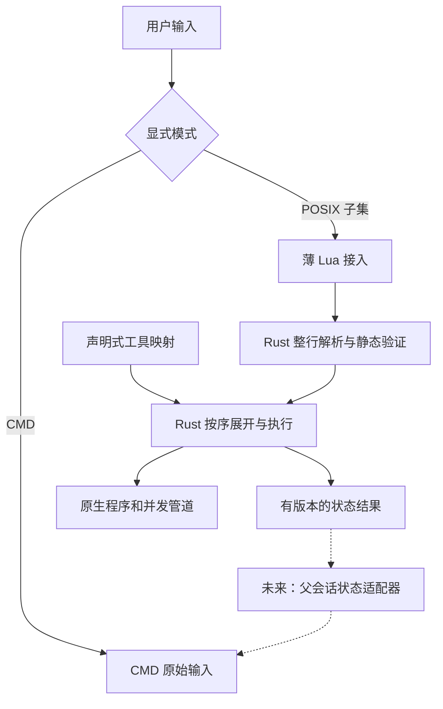

# Clink 原生执行器：模型边界与演进约束

状态：2026-10-11，Rust 性能原型，dialect 0.1。已经实现原生执行和隔离会话中的薄 Lua 接入；没有替换当前安装，也不等价于旧 Python 版的完整功能集。

## 1. 产品定位

目标是让 Windows 原生工具获得明确、可预测的交互命令语法。它不是 Bash 的兼容实现，不读取 `.sh` 脚本，不模拟 Unix 进程、文件系统、权限或终端模型。

采用**一种明确的语法模式 + 一个有版本的子集**。禁止通过“命令看起来像 Linux”“出现单引号”“程序名是 sort”来决定整行语义。相同模式下，相同源码必须始终得到相同解释。

预览版只接管 `nx <整行>`；其他输入原样交给 CMD。未来可以增加明确的 POSIX 会话模式，并在提示符显示模式。`source`、完整脚本、后台作业等需求交给用户显式选择的 Bash。不会在解析失败、程序找不到或运行失败后自动换 shell 重试，避免命令被执行两遍。

## 2. 模块职责

| 模块 | 拥有的职责 | 不得承担的职责 |
|---|---|---|
| Clink Lua 接入 | 显式模式、输入传输、退出状态入口、补全展示 | 第二份 POSIX 解析器、提前执行 `$()`、猜测 CMD 引号规则 |
| `syntax.rs` | 整行词法/语法分析、带引号信息的 AST、静态拒绝不支持结构 | 启动程序、读取替换输出、修改目录/环境 |
| `execute.rs` | 按 AST 顺序展开、短路、局部状态、流和子进程生命周期 | 把展开结果重新拼成 shell 源码、修改父 CMD 内存 |
| `platform.rs` | Windows 标准句柄复制、匿名管道 | 业务语法和命令路由 |
| `tools.tsv` | 命令名到绝对可执行文件和固定参数的映射 | 执行任意脚本、继承 DOSKEY 的字符串宏语义 |
| 父会话状态适配器（未实现） | 验证并提交 cwd/env/status 结果 | 静默修补执行器的语义错误 |

图中虚线框表示预览接入或尚未实现的集成边界。图源保存在 `architecture.mmd`，下面可由支持 Mermaid 的本地阅读器渲染；没有依赖外部渲染服务。



## 3. dialect 0.1 的明确承诺

| 能力 | 当前语义 |
|---|---|
| 单引号、双引号、空参数、相邻片段 | 保留引号来源；单引号内容不展开；UTF-8 请求 |
| 反斜杠 | Windows 友好规则，普通路径分隔符保留；只转义已列明的特殊字符。**不宣称完全等同 POSIX**；路径推荐用单引号或正斜杠 |
| `$NAME`、`${NAME}`、`$?` | Windows 环境名大小写不敏感；HOME 可回退 USERPROFILE，PWD 来自执行上下文 |
| 字段拆分 | 仅未加引号的变量/命令替换结果按空格、制表符、LF 拆分；不读取 IFS；不对结果二次展开或做 glob |
| `$()` | 仅到达该命令时执行；嵌套 AST 预先验证；隔离 cwd/env；要求输出 UTF-8，去掉尾部 CR/LF，拒绝 NUL |
| `<()` | **有限内容的文件替换**：生产者完成后，把临时文件路径作为一个参数。支持二进制；单个输出上限 8 MiB；不是 FIFO/流式替换 |
| `;`、`&&`、`\|\|` | 依次执行、短路；整行语法通过后才开始执行 |
| `\|`、`\|&` | 匿名管道并发执行；字节不转码；每阶段独立 cwd/env；状态为最后一阶段，无 pipefail |
| 重定向 | `< > >> 1> 1>> 2> 2>> &> &>> 2>&1 1>&2` 按书写顺序应用；`\|&` 在显式重定向之后合并 stderr |
| `<<<` | 生成 UTF-8 内容加 LF 的临时文件，无字段拆分 |
| 内建命令 | `echo`（只特别处理 `-n`）、`pwd`、`cd`、`true`、`false`、`export`、`unset`；内建名称区分大小写 |
| `NAME=value` | 赋值顺序从左到右；本原型所有变量均为可传给子进程的环境变量；命令前缀赋值仅对该命令有效 |
| 仅赋值的命令 | 成功状态为 0，即使赋值中命令替换返回非零；这是当前子集边界，不承诺 Bash 的替换状态传播 |
| 命令查找 | 优先显式工具映射，其次 PATH 中的 `.exe/.com`；不隐式搜索 cwd，不自动执行 `.cmd/.bat`；`./tool.exe` 可显式指定 |
| 扩展名/解释器 | 显式调用 `cmd.exe`、`bash.exe` 等时，后续源码由该程序自己的规则解释；它们不是隐式后备执行器 |

静态验证能够防止“前半行已执行，后半行才发现未闭合引号或不支持语法”。它不是事务：文件打不开、程序运行失败、动态命令名非法等运行时错误不会撤销已经完成的命令。退出状态沿 `&&` / `||` 正常传播。

内建命令只提供以上最小行为，不复制全部同名 GNU 工具选项。嵌套命令替换的非零状态不会自动中断外部命令；外部命令的状态由自身决定。`<()` 生产者状态同样不作为消费者状态传播。

**现在明确拒绝**：source、`.`、eval、exec、函数、循环、if/case、子 shell 命令组、后台 `&`、作业控制、反引号、算术、参数默认值/字符串运算、未引号保护的 glob/方括号/花括号/波浪号、heredoc、多行输入。不要把这些不支持项静默当成字符串或交回 CMD。

**可能逐项加入**：glob（明确大小写、隐藏文件、无匹配和排序规则）、`${x:-default}`、简单 argv 别名。每项先写语义和边界用例，再实现。v0.1 不导入 DOSKEY 宏；未来别名只能是“固定程序 + 固定参数”，不引入带 `|`、`&`、`$*` 的字符串宏语言。

## 4. 状态边界是单独的工程问题

预览版 `cd` / 赋值 / export / unset **仅在这次提交的整行中生效**：

```text
nx cd 'D:/project'; export MODE=dev; tool.exe
```

这一行中的后续命令和替换能看到变化，下一次提示符的父 CMD 不会改变。这是有意限制。把 Python 换成 Rust 不会使子进程获得修改父进程环境或 cwd 的能力。

执行器可以输出 `--state` 声明式结果：`V` 协议版本、`R` 退出状态、`C` UTF-8 hex 目录、`S` 环境变量设置、`U` 删除。当前只允许新建结果文件，消费者必须等进程结束后读取；原型不提供原子提交、请求身份验证或自动应用。

在正式集成前，状态协议必须增加请求 ID、完整性/完成标记、原子发布和会话基线版本。有效的非零退出结果仍可能包含合法状态变化，不能只因非零就丢弃。缺失、截断、版本不匹配、崩溃结果一律不应用。

父 CMD 的持久 cwd 适配必须独立验证。之前 Lua 回调中的 `os.chdir` 会受到 Clink 的目录恢复行为影响，不能认为调用 API 就已经持久改变父 CMD。受约束的 CMD 内建同步方案若要保留，必须证明 Unicode、`% ! & ^`、UNC、延迟展开开关和失败退出状态正确；不通过就继续使用显式行内状态，不能偷换承诺。

## 5. 性能模型与直接执行路径

当前实现每行一个短生命周期 Rust 进程；不需要常驻服务，不创建 Python 进程。单个外部工具额外再启动一个进程；两段管道启动两个工具进程和两个协调线程；命令替换在同一执行器内部运行，额外使用一个排空输出的线程；`<()` 再增加有限临时文件。普通 echo/sort/管道不会创建执行器临时目录。

原生启动仍有成本。后续保留直接执行路径，但**只接受语义等价可证明的字面量命令**。命令解析规则的权威实现只能有一份：直接路径是小范围的接受条件，不是 Lua 复制完整 Rust 语法。遇到展开、通配符、内嵌引号、CMD 元字符或不确定的 argv 规则就走执行器，不能猜测。

Windows 程序不共享一种完整的 argv 解析规范。Rust `Command::args` 适用于常见 CRT 规则；使用自定义参数解析的程序必须纳入适配白名单或显式使用自己的 shell。不能把“绝不调用 CMD”误写成“任意 Windows 程序都能逐字接收所有参数”。

不要同时维护两套管道、两套展开器或两套别名语言。更不应为了十几毫秒立即引入常驻服务；那会增加 IPC、断线重连、环境刷新、多终端隔离、版本升级和后台资源治理成本。只有测量证明有必要，再独立评估。

## 6. 生命周期与资源预算

已实现：64 KiB 输入上限、16 层替换、32 段管道、4096 个单命令参数、单次替换 8 MiB 上限、线程/句柄作用域释放、生产者输出并发排空、下游提前关闭的正常收尾，以及普通成功/失败后的临时文件清理。

8 MiB 是**单次捕获的输出字节上限**，不是进程总内存限制。并发/嵌套捕获、UTF-8 字符串和参数复制可能叠加内存；进程替换当前先缓存在内存，再写文件。这一实现用于验证行为和成本，不适合无界日志流。

正式安装前还需要：整条执行树的总捕获/临时文件预算；嵌套并发上限；取消信号传播；Windows Job Object 或等价的后代进程回收策略；读端溢出后终止不配合的生产者；超时/中断后的清理；强制退出遗留文件的有限范围回收。外部程序无限运行没有被原型自动限制，测试工具的超时也不能当成执行器自身的取消能力。

## 7. 编码与终端

输入请求/状态和文本替换采用 UTF-8，管道和文件重定向保持字节。非 UTF-8 的命令替换报错，二进制内容应走管道或 `<()`。`/dev/null` 映射 Windows NUL。

现阶段内建输出通过标准句柄写 UTF-8 字节。文件/管道已验证；不同控制台代码页下的显示、交互式 stdin、ConPTY、Ctrl+C、全屏程序、双宽字符都需要单独验收。不能用重定向文件中的 Unicode 测试代替终端显示测试。正式接入前应选择明确的控制台输出策略，不能悄悄永久修改全局代码页。

## 8. 演进规则和验收关口

1. 先写支持边界和反例，再增加 AST 节点；禁止字符串替换式“补丁”。
2. 对共同语法做旧版差分；另外对定义好的语义做独立断言。旧 Python 实现不是 POSIX 标准，也不能作为唯一真值。
3. 新功能不得使之前拒绝的语法悄悄在另一种 shell 中运行；改变已有意义要升级 dialect 版本。
4. 不以安装更多工具扩大执行器职责。工具配置、命令语法、Windows 平台适配分别维护。
5. 直接路径和完整执行路径用同一组 argv 黑盒用例证明一致，尤其空参数、尾部反斜杠、引号、`%` 和 `!`。
6. 发布前必须通过实际 Clink 会话、父状态、取消/后代进程、终端编码和资源预算验收；性能数字本身不是安装条件。

本阶段建议：继续采用 Rust + 薄 Lua；保留本原型作为明确子集的基础。下一阶段优先解决状态与取消，而不是抢先补 source、循环或完整脚本兼容。
